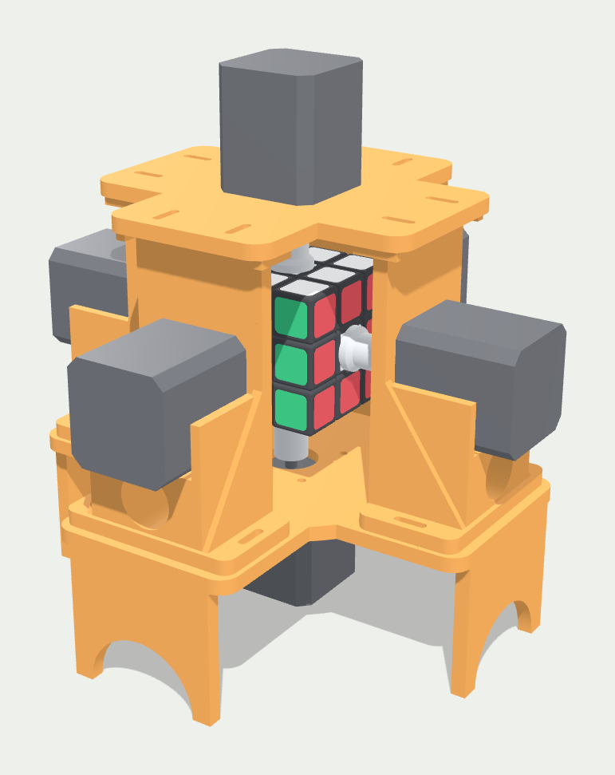
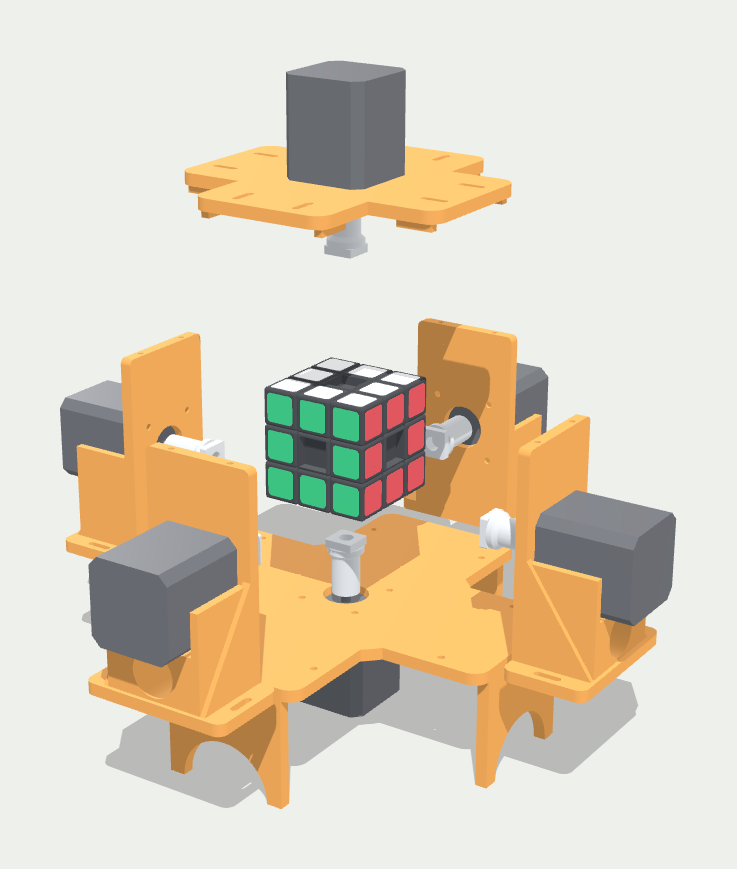
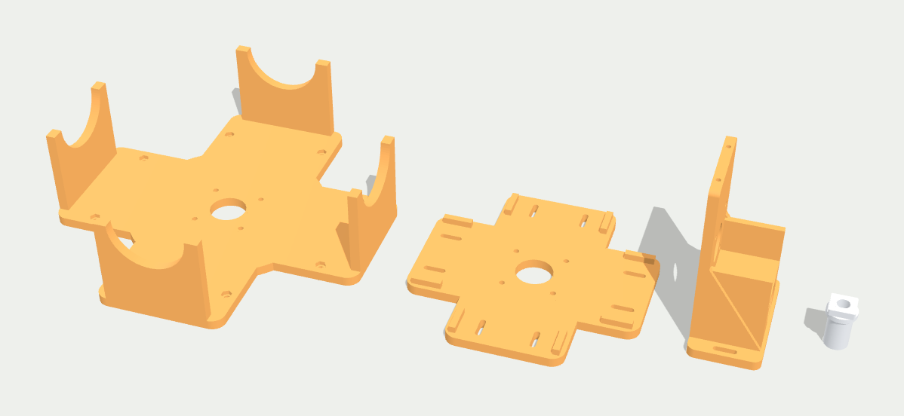

# Rubik's Cube Solver Robot

A six-motor robot that solves a 3x3 Rubik's cube, aiming for about 1 to 1.5
seconds. Each face's centre piece is coupled directly to a stepper motor, so
any face can be turned without regripping the cube.

<p align="center">
  
</p>

The pictures on this page are renders of the CAD model. Nothing has been
printed or assembled yet.

```
 webcam ──► software/ (Python) ──USB serial──► firmware/ (Teensy 4.1) ──► 6 × TMC5160 ──► 6 × NEMA 17
            scan colours                        parse moves
            solve (two-phase)                   step motors
```

## Hardware

| Part | Choice |
|---|---|
| Motors | 6 × StepperOnline 17HE19-2004S (NEMA 17, 0.55 Nm, 2.0 A) |
| Drivers | 6 × TMC5160 SilentStepStick, configured over SPI |
| Controller | Teensy 4.1 (3.3 V logic) |
| Supply | 24 V |
| Cube | YJ YuLong V2 M, 56 mm, magnetic |
| Frame | 3D printed, generated by `cad/frame.py` |

Full parts list with prices: `docs/BOM.md`. Wiring and assembly:
`hardware/README.md`. Research behind the choices: `docs/build-plan.html`.

## How it works

1. **Scan.** Hold each face up to the webcam. `scanner.py` samples the 9
   stickers and classifies their colours.
2. **Solve.** `solver.py` builds the 54-character facelet string and runs
   Kociemba's two-phase algorithm, which usually finds a solution in about 20 moves.
3. **Execute.** The move string (e.g. `R U' F2 D ...`) is sent over USB serial
   to the Teensy, which turns the matching motor 90° or 180°. Consecutive
   moves on opposite faces run at the same time.

## Repo layout

| Path | What's in it |
|---|---|
| `software/` | Python: colour scanner, solver, serial sender |
| `firmware/cube_solver/` | Teensy 4.1 sketch: serial protocol, TMC5160 setup, stepping |
| `firmware/host_test/` | Runs the sketch on a computer against simulated drivers |
| `cad/` | Python scripts that generate the printed parts, and the STL files |
| `hardware/README.md` | Assembly, wiring, cube preparation, bench test |
| `docs/BOM.md` | Bill of materials with prices |
| `docs/build-plan.html` | Research and feasibility calculation |
| `docs/parts-viewer.html` | 3D view of the printed parts |
| `docs/enclosure-options.html` | Ten frame layouts compared by printed plastic |
| `docs/img/` | CAD renders used in this README |
| `cad/step/` | The whole robot as a STEP assembly, for Autodesk Inventor |
| `CLAUDE.md` | Project context: decisions, conventions, open work |

## Quick start: solver

```bash
cd software
python3 -m venv .venv
source .venv/bin/activate     # Windows: .venv\Scripts\activate
pip install -r requirements.txt

# Test the solver with no hardware attached:
python solver.py --demo

# Full run: scan with the webcam, solve, and send moves to the robot
python solver.py --port /dev/cu.usbmodem1234561     # Windows: --port COM3

# Send moves directly, with a quarter-turn time of 50 ms
python solver.py --port /dev/cu.usbmodem1234561 --turn-ms 50 --moves "R U R' U'"
```

On macOS, `ls /dev/cu.usbmodem*` lists the Teensy's port.

## Quick start: firmware

Install the Arduino IDE with Teensyduino, open
`firmware/cube_solver/cube_solver.ino`, choose the Teensy 4.1 board and upload.
The sketch needs no extra libraries.

Commands, one per line over USB serial:

| Command | Effect |
|---|---|
| `R U' F2 D B L'` | Runs the moves, replies `DONE <ms>` |
| `PING` | Replies `PONG` |
| `ON` / `OFF` | Enables or disables the motors. `OFF` lets you turn faces by hand. |
| `TURN <ms>` | Time for one quarter turn, 10 to 1000. Starts at 60. |
| `SETTLE <ms>` | Pause after each move, 0 to 500. Starts at 5. |
| `CURRENT <mA>` | Motor current, 200 to 2800. Starts at 2000. |
| `STATUS` | One line per driver with its chip version and any faults |

To check the sketch without hardware:

```bash
firmware/host_test/run.sh
```

This compiles the real sketch against a stand-in Arduino API with six
simulated drivers and checks the register values, step counts and timing. It
does not prove the sketch compiles for the Teensy or that real motors keep up.

## Quick start: printed parts

Everything in `cad/` is generated from Python, so each dimension is a named
number that can be changed and regenerated.

```bash
pip install manifold3d trimesh numpy matplotlib
cd cad
python bench_stand.py --no-preview   # one-motor test stand and shaft adapter
python frame.py                      # six-motor frame, with collision checks

pip install cadquery
python inventor_export.py            # whole robot as a STEP assembly for Inventor
```

The frame is six printed parts: a base, four identical towers and a top plate
that lifts off to load the cube. One shaft adapter design fits all six motors.

<p align="center">
  
</p>

The printed parts as they lie on the print bed (base, top plate, tower, shaft
adapter):

<p align="center">
  
</p>

About 400 to 520 g of PLA for the whole frame at 20 to 40% infill, estimated
from the STL files. Other frame layouts that were considered are compared in
`docs/enclosure-options.html`.

## Face / motor mapping

| Face | Notation | STEP | DIR | CS |
|---|---|---|---|---|
| Up | U | 2 | 3 | 4 |
| Right | R | 5 | 6 | 7 |
| Front | F | 8 | 9 | 10 |
| Down | D | 14 | 15 | 16 |
| Left | L | 17 | 18 | 19 |
| Back | B | 20 | 21 | 22 |

Teensy pin numbers. SPI is shared on pins 11 (MOSI), 12 (MISO) and 13 (SCK).
All six drivers share ENABLE on pin 23 (active LOW).

## Status

- [x] Solver pipeline (`software/`)
- [x] Research and bill of materials
- [x] Order parts
- [x] Design the bench stand and six-motor frame (`cad/`)
- [x] Firmware for Teensy 4.1 and TMC5160, including opposite faces together
- [ ] Compile and flash the firmware on a real Teensy
- [ ] Measure the cube's centre recess and regenerate the shaft adapter
- [ ] Print the bench stand and run the one-motor test
- [ ] Print and assemble the frame
- [ ] Calibrate colour thresholds for your lighting
- [ ] Scan the cube inside the robot instead of by hand

What is and is not verified:

- Nothing has been printed, wired or run on real hardware yet.
- The firmware has only been run in the host test. It has not been compiled
  for the Teensy.
- Motor and cube dimensions come from the motor datasheet and the cube's
  product listing, not from measuring the real parts.
- The shaft adapter's tip is a placeholder until the cube is measured.
- The speed target is a calculation: 40 to 45 ms per quarter turn at 24 V.
  The bench test in `hardware/README.md` is what confirms it.
